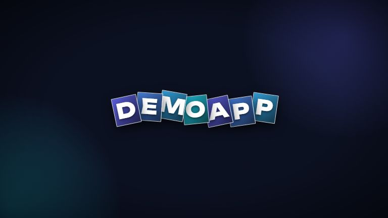
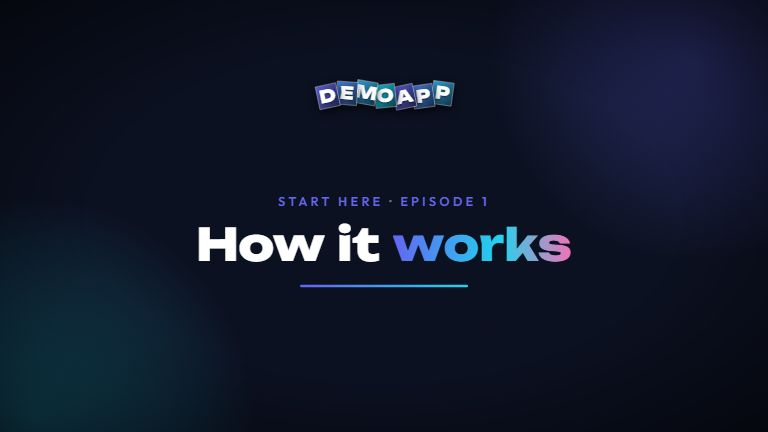
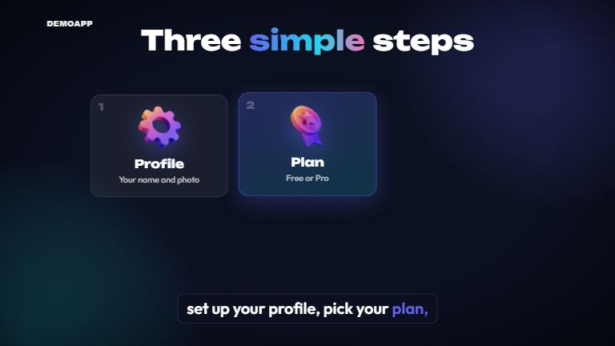
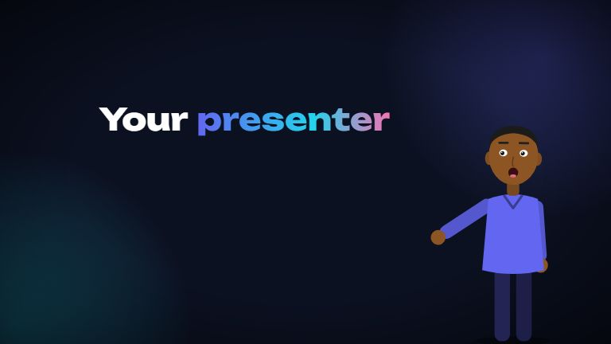

# Project Video Studio

**Turn any software project into a series of polished tutorial and explainer videos, made by your coding agent.**

Point your AI coding agent (Claude Code, Codex CLI, Gemini CLI, Cursor, Cline, OpenCode, Aider…) at a project and ask for videos. It reads the codebase to understand the product, its users, its brand (logo, colours, fonts) and the kind of music that fits. Then it asks you a few setup questions, plans the series and writes fact-checked scripts. From there it captures real app screens, generates natural voice-over with word-timed captions, builds the videos in [Remotion](https://www.remotion.dev), renders them, and prepares thumbnails and YouTube SEO. Everything works **for free** by default. It was battle-tested producing a 27-video education series.

<p>
  
  
  
  
</p>

## Features
- **Understands the project first:** product, roles and flows from the code. Brand detection (`detect-brand.mjs`) finds the logo, colours, fonts, name and URL. A **sound brief** picks music and effects that suit the product (playful for a kids' app, calm for a bank, punchy for a game).
- **First-run setup questionnaire:** goal, audience, format (16:9, 9:16, 1:1 or both), length, style, visuals, energy, captions, voice, accent, cast, tone, publishing, branding, music and approvals. The questions are a versioned data file; new questions are only asked of projects that haven't answered them.
- **Five styles:** motion explainer, screen tour (zoom + cursor + spotlight on real screens), animated presenter (a lip-synced cartoon host), real person / AI avatar, kinetic typography.
- **Free voices** (Microsoft Edge neural voices via `edge-tts`, no key) with word timings for captions and animation beats. Optional: Azure (free tier key), ElevenLabs, or your own recorded voice.
- **Free open media library:** sound effects and music from [Openverse](https://openverse.org) (CC0 / public domain / CC BY), plus optional Freesound, Pexels and Pixabay. Every file's license and credit is recorded, and CC BY credits are added to YouTube descriptions automatically. A starter pack of CC0 sound effects ships in the repo, so it works offline.
- **Real screens** captured with Playwright, signed in as each user role.
- **Production pipeline:** stills check before rendering, a one-at-a-time render queue, loudness normalised to YouTube level (−14 LUFS), branded intro/outro, burned-in captions, thumbnails, SEO titles/descriptions/tags/chapters.
- **System check + speed estimate:** `doctor.mjs` checks the PC against the requirements and benchmarks render speed, so you know how long a batch will take before you start.
- **Upgradable:** `sync-kit.mjs` updates a project's video kit without touching its episodes and backs up everything it replaces.

## Works with
| Agent | Cost | How |
|---|---|---|
| Claude Code | Claude Pro/Max plan or API credits | Clone into `~/.claude/skills/`; it's picked up automatically |
| Gemini CLI | free tier available | Clone anywhere, reference `SKILL.md` from your `GEMINI.md` |
| Codex CLI | ChatGPT plan or API | Reference `SKILL.md` from your `AGENTS.md` |
| Cursor / Windsurf | free tier available | Add a project rule pointing at `SKILL.md` |
| Cline / Roo / OpenCode / Aider | free with free/local models | Reference `SKILL.md` in your rules or prompt |
| **No agent** | free | `node scripts/setup.mjs`: terminal wizard, then the npm scripts |

Details per agent: [docs/using-with-agents.md](docs/using-with-agents.md). A free claude.ai *chat* can't run this, because rendering needs your own computer.

## Quick start

**A. With Claude Code**
```bash
git clone https://github.com/spiritphilip/project-video-studio ~/.claude/skills/project-video-studio
pip install edge-tts                                      # free voices
node ~/.claude/skills/project-video-studio/scripts/doctor.mjs
```
Then, inside any project: *"Make tutorial videos for this app."*

**B. With another agent**
```bash
git clone https://github.com/spiritphilip/project-video-studio ~/tools/project-video-studio
pip install edge-tts
node ~/tools/project-video-studio/scripts/doctor.mjs
```
Add one line to your agent's instructions file (see [docs/using-with-agents.md](docs/using-with-agents.md)):
`For videos about this project, follow ~/tools/project-video-studio/SKILL.md.`

**C. Without an agent**
```bash
node ~/tools/project-video-studio/scripts/setup.mjs --project /path/to/your/app
cd /path/to/your/app/videos && npm run dev              # Remotion Studio
```
The wizard detects your brand, asks the setup questions, scaffolds `videos/`, builds the media library and downloads fonts. Then write scripts in `scripts/videos/*.json` and use `npm run voice`, `npm run stills`, `npm run render`.

## Requirements and speed
| | Minimum | Recommended |
|---|---|---|
| CPU | 4 cores | 8+ cores |
| RAM | 8 GB | 16 GB |
| Free disk | 10 GB | 30 GB, SSD |
| Node.js | 20.19+ | 22 LTS |
| Python | 3.9+ (only for free edge voices) | same |
| GPU | not needed (renders on the CPU) | |

| Video length | Render time, minimum PC | Render time, recommended PC |
|---|---|---|
| 30 s | ~4–8 min | ~1–3 min |
| 60 s | ~8–15 min | ~2–5 min |
| 90 s | ~12–20 min | ~3–7 min |
| 3 min | ~25–40 min | ~6–14 min |

These are estimates: a CPU-only laptop measured about 1–2 minutes of rendering per 15 s of video. After scaffolding a project, run `node scripts/doctor.mjs --dir <project>/videos --bench` to measure your own machine. The full per-video timeline (script → screens → voice → build → check → render → upload) is in [docs/requirements.md](docs/requirements.md).

## Free vs optional services
| Service | Used for | Needs | Cost |
|---|---|---|---|
| edge-tts (default) | voice-over + word timings | `pip install edge-tts` | free, no key (unofficial endpoint) |
| Azure Speech | same voices, official API | `AZURE_SPEECH_KEY`, `AZURE_SPEECH_REGION` | free tier (0.5M chars/month) |
| ElevenLabs | most natural voices | `ELEVENLABS_API_KEY` | paid |
| Openverse | music + sound effects | nothing | free |
| Freesound | more CC0 sound effects | `FREESOUND_API_KEY` | free key |
| Pexels / Pixabay | stock video | `PEXELS_API_KEY` / `PIXABAY_API_KEY` | free key |
| HeyGen / D-ID | AI avatar presenter | `HEYGEN_API_KEY` / `DID_API_KEY` | paid |

Keys live in `~/.video-studio/secrets.env` (template: `setup/secrets.example.env`) and are shared by every project. They never go into git.

## How it works
```
understand project ─► brand + sound brief ─► setup questions ─► scaffold videos/
        │
        ▼
video list ─► scripts (fact-checked) ─► screens (Playwright, per role) ─► voice (word timings)
        │
        ▼
build episodes (Remotion kit) ─► stills check ─► render queue (−14 LUFS) ─► thumbnails + SEO ─► publish
```
Every animation beat is placed on a spoken word: `at('lineId', 'word')`. Change the script, re-voice, and the timing follows.

## Styles
| Style | Best for |
|---|---|
| Motion explainer | concepts, onboarding, "what is this" |
| Screen tour | "how do I…" tutorials on real screens |
| Animated presenter | friendly series with a recurring host |
| Real person / AI avatar | founder-led or human-feel content |
| Kinetic typography | Shorts, ads, music-only clips |

More: [references/styles.md](references/styles.md).

## Layout
```
SKILL.md                 the workflow agents follow
setup/                   questions.json, voices.json, library.json, secrets.example.env
scripts/                 setup, detect-brand, scaffold, library, doctor, sync-kit
template/                the Remotion project copied into each project (kit, scripts, icons)
assets/starter/          CC0 sound effects that ship with the repo
references/              detailed guides (understand, scripts, capture, voice, build, styles, publish, lessons, assets, extending)
docs/                    agents.md, requirements.md, images
```
In your project it creates `videos/`, a self-contained Remotion project with `video.config.json`.

## Media licensing and credits
- Sound effects are CC0 / public domain. Music is CC0, public domain or CC BY. Stock video uses the Pexels or Pixabay license. Each file's source, author and license is in `credits.json` (library) and `public/credits.json` (project).
- CC BY items need a credit; `npm run seo` adds the lines to your YouTube descriptions. Keep them if you publish elsewhere.
- 3D icons: [3dicons](https://3dicons.co), CC0.
- Use only fonts you are licensed to publish with; the kit defaults to free Google Fonts.

## Remotion license
This kit uses Remotion, which is **free for individuals and companies of up to 3 people**. Larger companies need a Remotion company license: <https://remotion.dev/license>. This repository's own code is MIT-licensed.

## Troubleshooting
| Problem | Fix |
|---|---|
| Render hangs on "Fetching … font" | `npm run fonts` (fonts load from disk afterwards) |
| Disk filling up / ENOSPC | Remotion temp bundles: the kit's scripts delete theirs; also clear old `remotion-webpack-bundle-*` folders in your OS temp folder and `out/raw` |
| `edge-tts` not found | `python -m pip install --user edge-tts` (on Windows use `py -m pip …` if `python` isn't on PATH) |
| Screen capture fails | `npm i -D playwright && npx playwright install chromium` |
| Library item "nothing suitable found" | run `library.mjs` again later (rate limits), add a free Freesound/Pexels key, or fetch with your own query |
| Voice line missing | `node scripts/tts.mjs scripts/videos/<id>.json` |
| Anything else | `node scripts/doctor.mjs --dir <project>/videos` |

## Contributing
New styles, voice providers, media sources and setup questions are welcome. See [CONTRIBUTING.md](CONTRIBUTING.md).

## License
[MIT](LICENSE) © 2026 spiritphilip and contributors.
